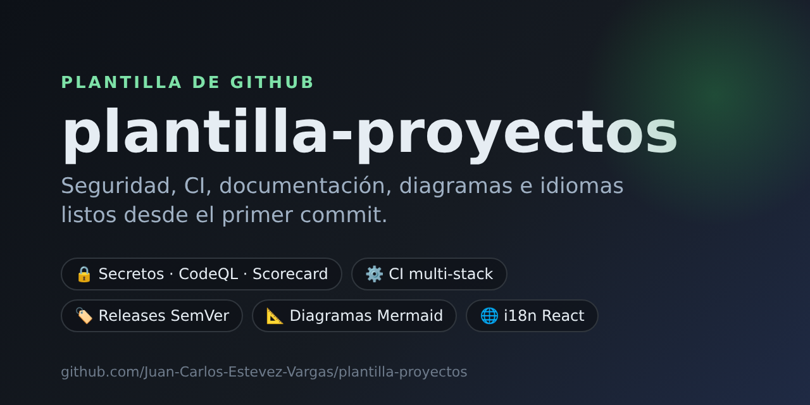
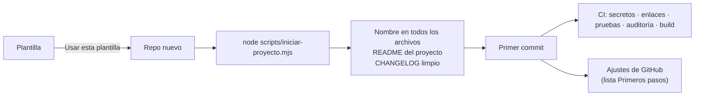

# Plantilla de proyectos

**Punto de partida para cualquier repo nuevo: seguridad, CI, documentación,
diagramas e idiomas listos desde el primer commit.**



[](https://github.com/Juan-Carlos-Estevez-Vargas/plantilla-proyectos/actions/workflows/ci.yml)
[](https://github.com/Juan-Carlos-Estevez-Vargas/plantilla-proyectos/actions/workflows/codeql.yml)
[](https://scorecard.dev/viewer/?uri=github.com/Juan-Carlos-Estevez-Vargas/plantilla-proyectos)
[](https://github.com/Juan-Carlos-Estevez-Vargas/plantilla-proyectos/releases)
[](LICENSE)
[](https://ko-fi.com/juancarlosestevezvargas)

<a href="https://github.com/new?template_name=plantilla-proyectos&template_owner=Juan-Carlos-Estevez-Vargas"></a>

## Contenido

- [Qué es](#qué-es)
- [Qué trae](#qué-trae)
- [Cómo usarla](#cómo-usarla)
- [Cómo funciona](#cómo-funciona)
- [Estructura](#estructura)
- [Scripts](#scripts)
- [Stacks que reconoce el CI](#stacks-que-reconoce-el-ci)
- [Documentación](#documentación)
- [Mantener la plantilla](#mantener-la-plantilla)
- [Contribuir](#contribuir)
- [Apoyar el proyecto](#apoyar-el-proyecto)
- [Licencia](#licencia)

## Qué es

Una plantilla de GitHub (*template repository*) que aplica el plan general de
proyectos de Juan Carlos Estevez Vargas: cada repo nuevo nace con la misma
base de seguridad, calidad, versionamiento y documentación, sin importar el
lenguaje. Sirve igual para una app web en React, una API en Spring Boot, un
script en Python o un ejercicio en C++.

## Qué trae

| Área | Qué incluye | Dónde |
| --- | --- | --- |
| Seguridad | Buscador de secretos sobre archivos, historial y build; CodeQL; OpenSSF Scorecard; Dependabot; política de reporte privado; tabla OWASP | [`scripts/check-secrets.mjs`](scripts/check-secrets.mjs), [`.github/workflows/`](.github/workflows/), [SECURITY.md](SECURITY.md), [SEGURIDAD_OWASP.md](docs/SEGURIDAD_OWASP.md) |
| CI | Detecta el stack y corre pruebas, auditoría de dependencias y build; revisa los enlaces de la documentación | [`ci.yml`](.github/workflows/ci.yml) |
| Versiones | Conventional Commits, SemVer, release automático al subir un tag `vX.Y.Z`, notas agrupadas y CHANGELOG | [`release.yml`](.github/workflows/release.yml), [CHANGELOG.md](CHANGELOG.md) |
| Documentación | README del proyecto con todas sus secciones, arquitectura, despliegue, legal, decisiones (ADR) | [`.plantilla/README.md`](.plantilla/README.md), [`docs/`](docs/) |
| Diagramas | Mermaid: arquitectura, datos, inicio de sesión, CI y despliegue, idiomas, uso de la plantilla | [DIAGRAMAS.md](docs/DIAGRAMAS.md) |
| Idiomas | Guía de i18n y base lista para React + TypeScript (español, inglés, portugués) | [IDIOMAS.md](docs/IDIOMAS.md), [`extras/i18n-react/`](extras/i18n-react/) |
| Contribuciones | Guía, código de conducta, plantillas de PR e issues, CODEOWNERS | [CONTRIBUTING.md](CONTRIBUTING.md), [CODE_OF_CONDUCT.md](CODE_OF_CONDUCT.md), [`.github/`](.github/) |
| Editor | `.editorconfig`, finales de línea LF en Windows y extensiones recomendadas | [`.editorconfig`](.editorconfig), [`.gitattributes`](.gitattributes), [`.vscode/`](.vscode/) |
| Apoyo | Botón **Sponsor** y enlace de Ko-fi | [`FUNDING.yml`](.github/FUNDING.yml) |

## Cómo usarla

1. Pulsa **[Usar esta plantilla](https://github.com/new?template_name=plantilla-proyectos&template_owner=Juan-Carlos-Estevez-Vargas)**
   y crea el repo nuevo.
2. Clónalo y, dentro de la carpeta, inícialo con un solo comando
   (requiere Node 20 o superior):

   ```bash
   node scripts/iniciar-proyecto.mjs --nombre "Mi proyecto" --descripcion "Qué es y para quién"
   # opcional: --sin-extras si no usarás la base de idiomas de React
   # opcional: --simular para ver qué haría sin tocar nada
   git add -A && git commit -m "chore: iniciar proyecto desde la plantilla"
   ```

   El script pone el nombre del repo en todos los enlaces, deja el README del
   proyecto en lugar de este, empieza un CHANGELOG limpio y se borra solo.
3. Sigue la lista **Primeros pasos** del README nuevo: los ajustes que solo se
   activan en GitHub (ramas protegidas, squash merge, secret scanning) y las
   secciones que dependen del stack.

## Cómo funciona



Los demás diagramas (arquitectura, CI y despliegue, versiones, idiomas) están
en [docs/DIAGRAMAS.md](docs/DIAGRAMAS.md).

## Estructura

```
.plantilla/            README del proyecto (el script lo pone en la raíz) e imagen para compartir
.github/
  workflows/           ci, codeql, scorecard, release
  ISSUE_TEMPLATE/      error y mejora (las vulnerabilidades van en privado)
  CODEOWNERS · FUNDING.yml · dependabot.yml · release.yml · pull_request_template.md
docs/
  ARQUITECTURA.md · DIAGRAMAS.md · DESPLIEGUE.md · IDIOMAS.md · LEGAL.md · SEGURIDAD_OWASP.md
  adr/                 decisiones de arquitectura, una por archivo
extras/i18n-react/     base de idiomas para copiar en src/ (opcional)
scripts/               secretos, enlaces e inicio del proyecto, con sus pruebas
```

## Scripts

Sin dependencias: solo Node 20 o superior.

| Comando | Qué hace |
| --- | --- |
| `node scripts/iniciar-proyecto.mjs` | Deja listo un repo recién creado desde la plantilla (una sola vez) |
| `node scripts/check-secrets.mjs --history` | Busca claves en los archivos y en todo el historial de git |
| `node scripts/check-secrets.mjs dist` | Busca claves en el build antes de publicarlo |
| `node scripts/check-links.mjs` | Revisa que los enlaces y anclas internas de los `.md` existan |
| `node --test "scripts/*.test.mjs"` | Corre las pruebas de los scripts |

## Stacks que reconoce el CI

El CI mira qué archivos hay y corre lo que corresponde. Cuando el proyecto
tenga su propio comando (por ejemplo `npm run check`), se reemplaza ese paso.

| Si encuentra | Corre |
| --- | --- |
| `package.json` | `npm ci`, `npm audit`, typecheck, lint, pruebas y build |
| `pom.xml` / `gradlew` | `mvn verify` / `./gradlew build` |
| `composer.json` | `composer install`, `composer audit`, PHPUnit |
| `pyproject.toml` / `requirements.txt` | `pip-audit` y pytest |
| `CMakeLists.txt` | build y CTest |
| Nada de lo anterior | Solo secretos, enlaces y pruebas de los scripts |

## Documentación

| Documento | Contenido |
| --- | --- |
| [Arquitectura](docs/ARQUITECTURA.md) | Piezas del sistema y cómo se conectan |
| [Diagramas](docs/DIAGRAMAS.md) | Diagramas en Mermaid de la arquitectura y de cada flujo |
| [Despliegue](docs/DESPLIEGUE.md) | Cómo montarlo, variables, versiones y vuelta atrás |
| [Seguridad](docs/SEGURIDAD_OWASP.md) | Estado de cada punto de seguridad |
| [Legal](docs/LEGAL.md) | Privacidad, datos personales y licencias |
| [Idiomas](docs/IDIOMAS.md) | Detección del idioma, selector y diccionarios |
| [Decisiones (ADR)](docs/adr/README.md) | Por qué se eligió cada pieza importante |
| [Cambios](CHANGELOG.md) | Historial de versiones de la plantilla |
| [Política de seguridad](SECURITY.md) | Cómo reportar una vulnerabilidad |

## Mantener la plantilla

- Un cambio que sirva para todos los proyectos se hace aquí primero, con su
  diagrama y su línea en el [CHANGELOG](CHANGELOG.md).
- Los textos que deben llevar el nombre de cada proyecto usan
  `NOMBRE-DEL-REPO` y `NOMBRE DEL PROYECTO`; el script los reemplaza.
- Al publicar una versión: `git tag v1.2.0 && git push origin v1.2.0`. El
  release sale solo con sus notas.
- Los repos ya creados no se actualizan solos: se copian a mano los archivos
  que cambiaron (las notas del release dicen cuáles).

## Contribuir

Lee la [guía de contribución](CONTRIBUTING.md) y el
[código de conducta](CODE_OF_CONDUCT.md). Los commits siguen
[Conventional Commits](https://www.conventionalcommits.org/es/).

## Apoyar el proyecto

Si esta plantilla te sirvió, puedes invitarme un café:

<a href="https://ko-fi.com/juancarlosestevezvargas"></a>

## Licencia

[MIT](LICENSE) © Juan Carlos Estevez Vargas
