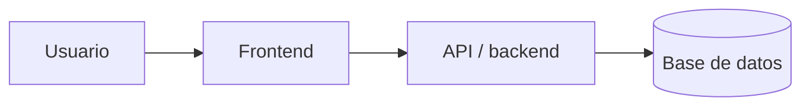
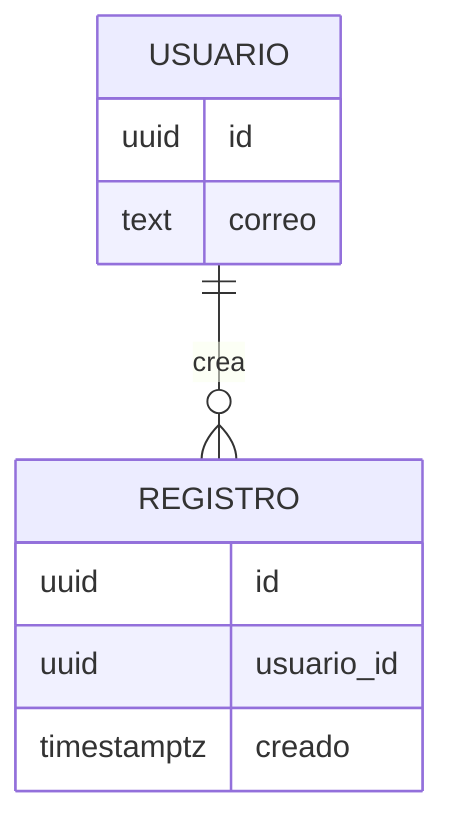
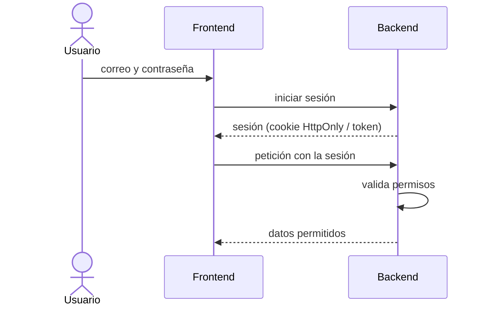
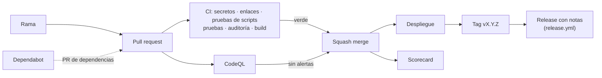
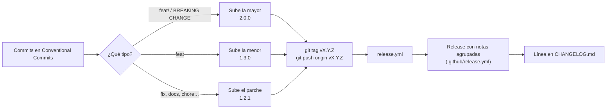
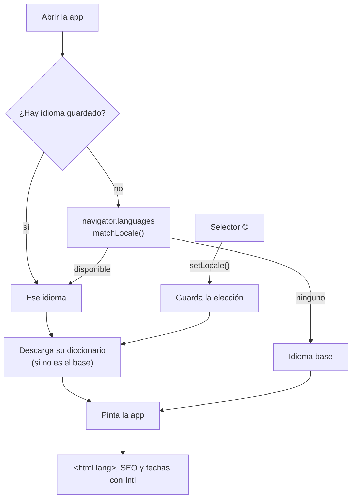
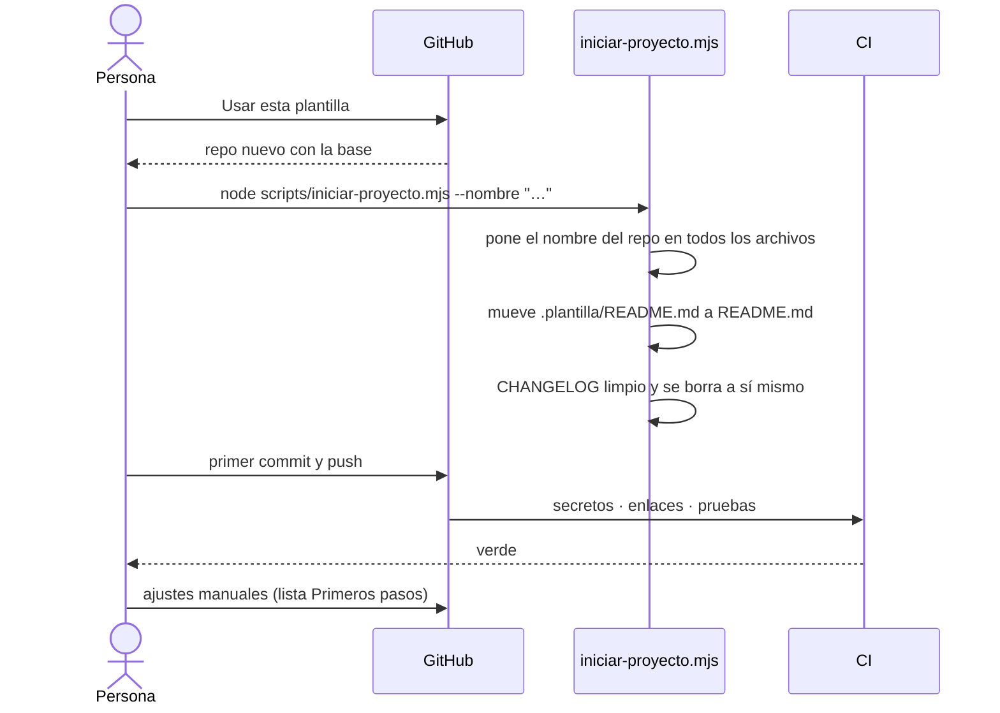

# Diagramas

Diagramas en [Mermaid](https://mermaid.js.org/); GitHub los dibuja solo. Cada
cambio en la app actualiza aquí el diagrama afectado o agrega uno nuevo.

- [Arquitectura general](#arquitectura-general)
- [Modelo de datos](#modelo-de-datos)
- [Inicio de sesión y permisos](#inicio-de-sesión-y-permisos)
- [Integración y despliegue](#integración-y-despliegue)
- [Versiones y releases](#versiones-y-releases)
- [Idiomas](#idiomas)
- [Inicio desde la plantilla](#inicio-desde-la-plantilla)

## Arquitectura general

## Modelo de datos

## Inicio de sesión y permisos

## Integración y despliegue

## Versiones y releases

## Idiomas

## Inicio desde la plantilla

